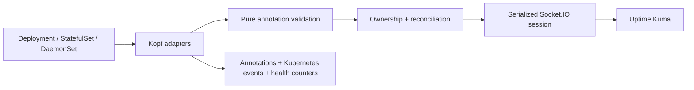

# Architecture



- `config.py`: environment and desired-state validation, annotation precedence,
  legacy aliases and exact HTTP code conversion. No network access.
- `reconciler.py`: ownership, reference resolution, managed-field comparison and
  mutations. Independent of Kopf, with stateful behavioral tests.
- `client.py`: one RLock covering connection, authentication and the complete
  remote transaction. Exceptions invalidate the session; the next attempt
  reconnects. Automatic Socket.IO reconnect is disabled because it does not
  repeat Kuma authentication. Timeout defaults to 10 seconds per client operation.
- `handlers.py`: resource selection, persistent marker, annotation progress,
  retries, resync, shutdown and health probe diagnostics. The synchronous handler
  pool is capped at one worker because all remote transactions share the same lock.
- `operator.py`: compatibility loader for existing CLI arguments. If Python
  discovers it as the stdlib operator module, it delegates to that runtime's
  complete stdlib implementation. Application code lives in the package.

## Ownership

The exact description `k8s:v2:["Kind","namespace","name","uid"]` identifies a
monitor. Kuma instance is the administrative scope. UID distinguishes recreated
resources and clusters. Display names are not ownership evidence: a conflicting
name blocks creation/rename rather than claiming another monitor. Existing
duplicate display names do not block reconciliation of an exact owned ID. Duplicate ownership
markers block mutations and require manual resolution.

Legacy `k8s:namespace/name` lacks kind/UID. It is adopted only with an exact match,
a unique remote candidate and explicit `uptime-kuma.io/adopt-legacy: "true"` on
the workload metadata. It is never deleted directly. Untagged monitors require
manual migration. Changing ownership descriptions externally requires manual
repair; the operator deliberately does not infer ownership from names/URLs.

## Reconciliation and lifecycle

1. Select enabled resources or those with the persistent managed annotation.
2. Parse and validate the entire desired configuration before remote access.
3. Persist `managed=true` before creating a monitor, so disable/removal remains
   observable across restarts.
4. Serialize list/ownership/reference resolution/compare/mutation.
5. Record outcome, effective config hash and observed generation in annotations.
6. On disable/delete, delete only the exact owned monitor. Missing monitor is a
   successful no-op. Clear the managed marker after successful disable cleanup.

Kopf attaches required deletion finalizers only to selected resources. A Kuma
outage can delay deletion of a managed workload; this intentionally prioritizes
external cleanup. Unmanaged workloads must not wait for Kuma. See migration.md
for pre-existing finalizers and emergency recovery.

Validation/ownership failures are retried after 300 seconds and surfaced as a
sanitized error annotation and warning event. Transient failures retry after
5, 10, 20, 40, 80, 160, then 300 seconds. Retry delays are capped; no credentials
or arbitrary remote error text are stored in Kubernetes. Periodic resync defaults
to 300 seconds. Repeated desired state does not issue edits. Only configured
fields are managed; the client merges unrelated existing monitor settings.

Controller-generated `managed`, `state`, `error`, `config-hash`, and
`observed-generation` annotations are excluded from the diff base. They are
outputs, not desired inputs. This prevents annotation/generation feedback loops
on Deployments while still detecting changes to user configuration.

## Operations and limits

Run one instance per watched scope and Kuma account. The Deployment uses Recreate,
not leader election. RLock serializes only one process; it cannot coordinate two
operator installations. Each reconcile lists monitors: this is O(N), suitable
for the current scope, not an established high-scale performance claim.

`--liveness=http://0.0.0.0:8080/healthz` provides Kopf health plus the configured
state and process-local outcome counters. The probe runs asynchronously on the
event loop, independently of the synchronous reconciliation worker pool. Liveness/readiness indicate process
availability, not successful authentication to Kuma. Kuma outages should be
alerted from reconciliation error events/counters. These counters reset on
restart and are not a Prometheus exporter.

Dynamic namespace/CRD discovery is disabled: the controller watches only stable
built-in apps/v1 resources and supports explicit namespaces or all namespaces.
No namespace/CRD list/watch permissions are necessary.

Default Kopf persistence keys and finalizer are retained. A custom
KUMA_ANNOTATION_PREFIX also isolates framework storage/finalizers; this is used by
E2E tests to avoid shared framework state with the production operator.

## Why this design

Python/Kopf retains the existing annotation contract and the established Kuma
Socket.IO client. Rewriting in Go would require rebuilding that integration
without a measured scale benefit. A custom watch loop would reimplement retry,
persistence, and lifecycle behavior already provided by Kopf.

No CRD is introduced: annotations are the existing user API, and dedicated
configuration hash/state annotations represent observed controller state without
adding foreign status conditions to built-in workload schemas. Dependencies are
passed directly to the reconciler; no dependency injection framework is needed.

A process-wide lock matches the shared Socket.IO session and prevents interleaved
read/create/edit/delete transactions. Single-instance Recreate is the current
coordination boundary; future HA needs a distributed lock rather than additional
in-process abstractions. See [limitations](limitations.md) for remaining work.

## Repository layout

```text
kuma_operator/   Runtime configuration, client, reconciler, and Kopf handlers
kubernetes/      Installation manifests and a minimal annotated workload
scripts/         Test provisioning, validation, and reporting
tests/          Behavioral unit, reconciliation, integration, and repository tests
docs/            Public usage, architecture, development, and migration guides
.github/         Validation and release workflows
operator.py      Compatibility entrypoint for existing deployments
```

Generated `artifacts/`, build output, coverage, virtual environments, and local
maintainer settings are outside the version-controlled source layout.

## Optional status pages

`status_page.py` handles whole-page reads, identity checks, conservative membership
merges and verified saves under the existing session lock. `reconciler.py` invokes
it after monitor reconciliation and before deleting a monitor. Configuration
explicitly reserves destination group IDs; there is no name-based adoption or
automatic group/page creation. See [status pages](status-pages.md) for the ownership
contract, manual-link refusal and single-writer limitation.
